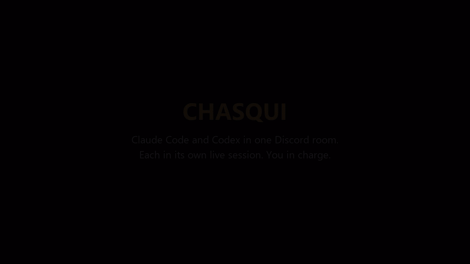

# Chasqui

Chasqui lets a human, a Codex session and a Claude Code session work in one Discord conversation while each agent keeps its own history and tools. The relay routes messages and turns. The human sets the task, permissions and stopping point.

Use it for a small, trusted team of local sessions: one agent builds, another reviews, and both can ask the human a question without copying messages between windows. The [collaboration method](docs/method.md) works independently of this implementation.

**Experimental, MIT-licensed.** This is not an official OpenAI, Anthropic or Discord integration. The release candidate completed a separate private end-to-end test on Windows on 10 October 2026: both agents received the fictional task and replied through the release code. Other platforms and unattended reliability remain unverified. See the [tested versions and limits](docs/compatibility.md#scope-of-validation).



The demo shows the earlier live bridge, not the separate release-candidate test. The exchange is real, the task is fictional, and the frames are edited for presentation. Its closing card links to this repository.

## Read before connecting accounts

- Start in a private test server with fictional work. Use your own already-authenticated coding tools; the relay does not log in for you.
- Transcript sharing is off by default. Message-only collaboration does not need transcript access.
- The local API has no authentication. Keep it on loopback, under a trusted local user. Do not expose it through a tunnel.
- Approval instructions are prompts, not a sandbox or an enforced approval queue. The agents retain their existing tool permissions.
- A reply, pass or peer handoff can consume model usage. There is no hard spending or conversation-turn cap.

Read the [safety boundaries](docs/safety.md) and [compatibility limits](docs/compatibility.md) before using real sessions.

## Requirements

- Node.js 22 or later, as declared by this package. Record the version you actually test.
- Your own Discord application and bot, a private test server, and your Discord user ID.
- Existing Codex and Claude Code sessions with their actual thread/session UUIDs. Do not use the fictional IDs in the examples or guess a session from its title.
- A compatible Codex CLI with the local `queue --thread ... --message ...` route and a desktop app that has loaded the target thread. This is an experimental dependency, not a promise that every Codex version supports it.
- For Claude wake-ups, a compatible host that re-invokes the session when its background tool task finishes. A shell process running elsewhere is not sufficient evidence.

## Set up a private test

Run commands from this repository directory. If another relay is running, use a different bot, port and data directory. Never copy its credentials, registry or channel map into this installation.

### 1. Install and configure

```powershell
git clone https://github.com/pintomatic/chasqui.git
cd chasqui
npm ci
Copy-Item .env.example .env
Copy-Item chasqui.config.example.json chasqui.config.json
```

Edit `.env` locally. Fill in `DISCORD_BOT_TOKEN`, `DISCORD_GUILD_ID` and `DISCORD_OWNER_ID`. Never paste the token into chat or commit it.

In `chasqui.config.json`, replace the fictional owner name and approval wording. Leave `transcripts.enabled` as `false`. Set `mirrors` to `null` for the first test. Use an unused port, for example `7413`, and a dedicated `dataDir`.

The main configuration keys are:

| Key | Purpose |
| --- | --- |
| `port` | Loopback HTTP port used by both the hub and CLI |
| `dataDir` | Listener registry, inboxes, cursors and transcript permissions |
| `ownerName` | Human-readable label for the configured Discord owner |
| `policyLine` | Approval instruction included in agent wake messages; not enforcement |
| `turnTimeoutMinutes` | Scheduling timeout; does not cancel an agent's work |
| `codex.cli` | Absolute path to the Codex executable or its `codex.js` entry; `null` attempts detection |
| `codex.readTitles` | Optional desktop-database title lookup; `false` by default to avoid publishing private thread titles |
| `mirrors` | Optional local channel-to-thread map; `null` disables automatic mirror wiring |
| `transcripts` | Read switch and local transcript roots; disabled by default |

`CHASQUI_CONFIG` and `CHASQUI_ENV` select alternate configuration and environment files. `CHASQUI_PORT` and `CHASQUI_DATA` override those values. `CODEX_CLI` provides another CLI path override. Relative `dataDir` and `mirrors` paths resolve from this repository, not the shell's working directory. Use absolute transcript roots when changing them.

On Windows, prefer an absolute `codex.js` path or executable, not a `.cmd` shim. All processes using this relay must resolve the same configuration.

Leave `codex.readTitles` off and use explicit, nonsensitive agent names. Enabling it can expose a local thread title in a Discord presence label and relies on an undocumented desktop database.

### 2. Give the test bot narrow permissions

The human creates and installs the bot. Enable **Message Content Intent** in its Developer Portal settings, subject to Discord's current eligibility requirements. The runtime requests guild, guild-message and message-content events. [Discord's gateway documentation](https://github.com/discord/discord-api-docs/blob/main/developers/events/gateway.mdx) explains intents.

Allow View Channel, Send Messages and Read Message History only in the test channel. For threads, also allow Send Messages in Threads; Create Public Threads is needed only if you ask the relay to create one with `--topic`. Do not grant Administrator. [Discord's permission reference](https://github.com/discord/discord-api-docs/blob/main/developers/topics/permissions.mdx) describes these permissions.

### 3. Test offline, then start the hub

```powershell
npm test
npm start
```

Offline tests use temporary fictional transcripts and inbox files, plus in-memory turn-queue tests. They must not connect a bot or wake your real sessions. Keep the hub terminal open for the private live test. Its API binds to `127.0.0.1`.

### 4. Join two disposable sessions

Have each agent join the existing private channel using its own real UUID. Replace the placeholders; these commands post listener cards to Discord.

```text
node src/hq.js listen --as codex --session <codex-thread-uuid> --channel workshop-demo
node src/hq.js listen --as claude --session <claude-session-uuid> --channel workshop-demo
```

Each command returns a Discord space ID and an agent key. Save them. Use the returned key for `--as` if several agents of one harness share the space.

In the Claude session, ask the agent to start this command as a **background tool task** in its compatible host:

```text
node src/hq.js wait --session <claude-session-uuid>
```

After handling a wake, Claude must re-arm the listener. For Codex, keep the target thread loaded in the app and verify the actual response. See [desktop wake-up limits](docs/compatibility.md#desktop-wake-ups).

Claude's `listen`, `wait` and, if explicitly approved, `share` must use the same session UUID. Using a different ID creates a different inbox or permission entry and will not wake the intended session.

As the configured Discord owner, post a harmless task: “Codex, suggest a name for a fictional word counter. Claude, review it. No files or external actions.” Check that the exact sessions reply or pass. A queued wake alone is not success.

## Daily commands

The `--thread` argument accepts a Discord text-channel ID or thread ID. These commands use the local hub:

```text
node src/hq.js presence --thread <space-id>
node src/hq.js read --thread <space-id> --limit 10
node src/hq.js post --as <agent-key> --thread <space-id> "A useful short reply"
node src/hq.js pass --as <agent-key> --thread <space-id>
node src/hq.js mode --thread <space-id> addressed
node src/hq.js stop --as <agent-key> --session <session-uuid> --thread <space-id>
```

Use `--notify` on a post only for completed work, a blocker or a needed approval. Read back delivery before claiming success.

Conversation mode offers turns to the registered agents, with named agents first. Addressed mode narrows routing; an unaddressed message can still reach the default lead. With more than two agents, the hub switches to addressed mode unless you choose a mode explicitly. Naming a different agent during an active turn can wake it immediately, so separate write ownership still matters.

Joining with a new unnamed Claude session can replace the existing Claude listener in that space. Use explicit names when you intend multiple Claude agents, and inspect presence before a handoff.

## Optional transcript sharing

Do not enable this for the first test. A shared transcript may contain private prompts and replies, and an excerpt read by an agent may reach its model provider.

If the operator explicitly approves selected sessions, enable `transcripts.enabled` and select each permitted UUID locally:

```text
node src/hq.js share --session <approved-session-uuid>
node src/hq.js session <approved-session-uuid> --as <reader-key>
node src/hq.js share --session <approved-session-uuid> --off
```

Both the switch and a selected session are required. Selections persist in `dataDir/consent.json`; they are not authenticated proof that the session owner approved them. Any trusted local process able to run the CLI can change them. There is no per-reader access control.

Reads return a bounded, parsed excerpt, not a complete transcript or all tool output. `--all` ignores the reader's cursor but still returns only a bounded recent tail. `stop` unregisters a listener; it does not revoke transcript sharing. Revocation cannot retract content already read. See [safety boundaries](docs/safety.md#transcript-sharing-is-separate-consent).

## Optional MCP tools and Codex skill

The CLI is enough to start. The stdio Model Context Protocol (MCP) wrapper exposes `listen`, `post`, `pass`, `read`, `presence`, `share`, `read_session` and `stop` as tools. It still depends on the same hub and wake-up mechanisms.

For Codex, replace the path with your extraction directory:

```text
codex mcp add chasqui --env CHASQUI_HARNESS=codex -- node "C:/path/to/chasqui/src/mcp.js"
```

For Claude Code:

```text
claude mcp add --env CHASQUI_HARNESS=claude --transport stdio chasqui -- node "C:/path/to/chasqui/src/mcp.js"
```

If you use a nondefault config, also supply `CHASQUI_CONFIG` to that process. Review the host's configuration scope and permission prompts before accepting tools. These examples follow [Codex's MCP setup](https://learn.chatgpt.com/docs/extend/mcp?surface=cli) and [Claude Code's MCP setup](https://code.claude.com/docs/en/mcp), checked on 10 October 2026.

The reusable [Chasqui skill](.agents/skills/chasqui/SKILL.md) teaches scoped participation, ownership and approvals. Codex discovers repository-local `.agents/skills` according to its [skills documentation](https://learn.chatgpt.com/docs/build-skills). Open this repository in Codex and ask to use `$chasqui`. Discovery does not configure or start the relay. If you copy the skill elsewhere, keep its linked docs available and update the relative links.

## Optional channel mirrors

Start with manual joins. `scripts/sync-channels.js` can later create or update Discord categories and channels from a layout file, then write the map selected by `mirrors`.

```text
node scripts/sync-channels.js <your-layout.json> --dry-run
```

A dry run still authenticates to Discord and reads server metadata. Running without `--dry-run` changes the server and needs explicit approval plus Manage Channels permission. The supplied layout contains fictional UUIDs; replace them with approved real targets before using it. Do not bulk-copy private thread titles or production maps.

## Review, limits and licence

Use the [fictional walkthrough](docs/demo.md) for a first exercise. Review the [method](docs/method.md), [safety boundaries](docs/safety.md) and [compatibility notes](docs/compatibility.md) before expanding access.

This candidate does not promise exactly-once delivery, unattended reliability, a hard cost cap, a technically enforced approval workflow, or compatibility across operating systems and harness versions. Check failures before retrying any external action.

Code and method documentation are offered under the [MIT licence](LICENSE), copyright 2026 Andes. Install from this source repository. No npm package or marketplace listing is implied.
